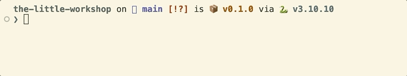

# The Little Workshop

**Un portfolio qui est un monde : ses habitants décident.**



Un visiteur tire un levier, la machine casse. Le Bricoleur, un robot, décide alors quoi faire : se déplacer, inspecter, poser un diagnostic, réparer. Chaque décision est tracée, y compris celles qu'il refuse.

## Où en est le projet

- [x] La boucle du robot en terminal
- [ ] Le levier par HTTP et les événements en direct (SSE)
- [ ] La scène 3D dans le navigateur
- [ ] Un LLM propose l'action, le moteur valide

## Essayer

```bash
uv sync
uv run pull-lever             # robot à 4 m : il se déplace d'abord
uv run pull-lever --near      # robot à côté : il inspecte directement
uv run pull-lever --wear 95   # usure élevée : diagnostic différent
uv run pytest
```

## Comment ça marche

`idle → moving → inspecting → repairing → idle`

Machine à états (state pattern) et simulation événementielle : chaque action produit ses effets sur le monde avant la décision suivante.
